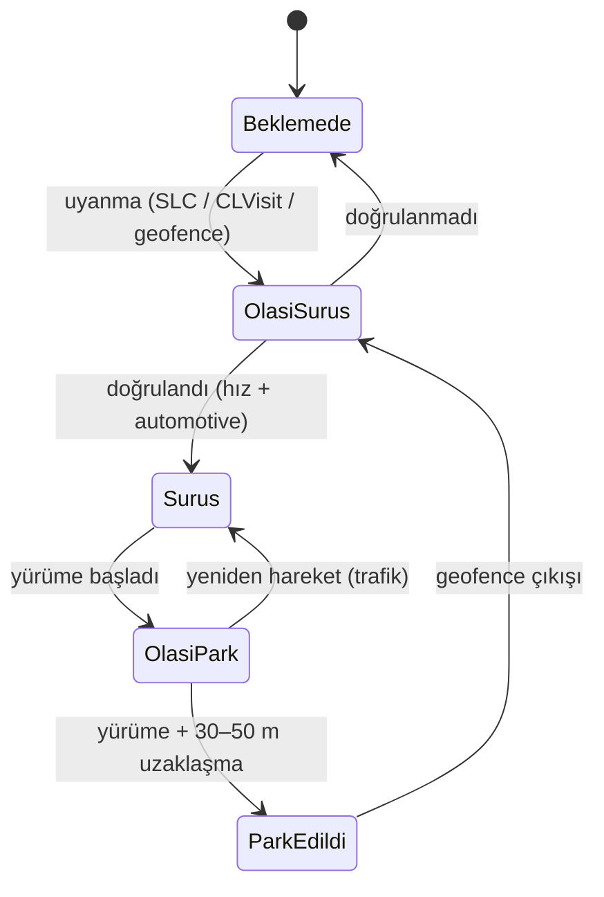

# CarCrumb — Karar Kaydı ve Ürün Spesifikasyonu

24 Kasım 2026 · Mustafa Kaplan
Kaynak: https://claude.ai/artifact/5zGEYqdmW9z6et96oRjreg (bu dosya o dokümanın Claude Code kopyasıdır; çelişki olursa ikisini birlikte güncelle)

## Ürün özeti

CarCrumb, iPhone'da araç yolculuklarını ve park konumunu OBD cihazı ya da ek donanım olmadan, kullanıcı hiçbir şeye dokunmadan otomatik kaydeden bir uygulama. Ana vaadi: **aracını nereye bıraktığını asla unutma, tüm sürüş geçmişin tek yerde olsun.**

- **Kimin için:** Aracını farklı yerlere park eden şehir sürücüleri; Bluetooth'u veya CarPlay'i olmayan, ya da telefonunu araca bağlamayan kullanıcılar.
- **Nasıl:** GPS, hız, Core Motion hareket verisi ve (varsa) araç Bluetooth/CarPlay bağlantısı birlikte değerlendirilir.
- **Gizlilik:** Tüm veriler cihazda kalır; hesap yok, sunucu yok.
- **Proje durumu:** Araştırma ve karar aşaması tamamlandı. Kod sıfırdan yazılacak; önceki DriveMate Faz 2 kodu kullanılmayacak.

## Konumlandırma ve rakipler

Asıl rakip iPhone'un kendisi: Apple Haritalar ve Google Haritalar park yerini ücretsiz kaydediyor, ama yalnızca araç Bluetooth'u veya CarPlay bağlantısı koptuğunda. Konumlandırmamız: **"Apple Haritalar'ın yapamadığını yapan uygulama."**

| Rakip | Ne yapıyor | Zayıf noktası |
| --- | --- | --- |
| [Apple Haritalar](https://support.apple.com/en-gw/101587) | Bluetooth/CarPlay kopunca park işareti | Bağlantı yoksa çalışmaz; ev ve iş gibi sık park edilen yerlerde işaret bırakmaz; geçmiş yok |
| [Parking Pin](https://apps.apple.com/us/app/parking-pin/id767796953) | Motion + konumla otomatik park | Son güncelleme Mayıs 2019, puan 3,2; fiilen terk edilmiş |
| MileIQ, Driversnote | Otomatik kilometre kaydı | İş/vergi odaklı, abonelik; kaçırılan ve geç başlayan yolculuklar en yaygın şikayet |
| [Trips](https://apps.apple.com/app/id6759853293) | Otomatik yolculuk, park yeri, CarPlay | Yeni, henüz yeterli puan yok; kısa duruşların yolculuğu bölmesi sorununu yaşamış |
| AutoTrips | Kısayollar otomasyonuyla kayıt | Algılamayı kendisi yapmaz; Bluetooth/CarPlay şart |

**Farklılaşma noktaları:**

- Bluetooth/CarPlay gerektirmeyen park algılama; ev ve işte de çalışır.
- Geç başlayan yolculuğun gerçek başlangıcını Core Motion geçmişinden geriye dönük bulma.
- Yanlış park kaydının doğru olanın üzerine asla yazılmaması.
- Kapalı otoparkta kat tahmini.

## Kapsam ve yol haritası

v1, park özelliğinin asıl değerini taşıyan en dar set. Konum izni verilmese de uygulama işe yaramalı (App Store kuralı 5.1.5).

| Sürüm | Özellikler |
| --- | --- |
| **v1** | Otomatik yolculuk algılama · otomatik park kaydı · "Arabam nerede" ekranı + Apple Haritalar'da yürüyüş rotası · yolculuk geçmişi (rota, süre, mesafe) · manuel düzeltme, yolculuk bölme ve birleştirme · ayarlanabilir durma eşiği · ana ekran widget'ı · teşhis ekranı · konumsuz mod (manuel park pini, manuel yolculuk, geçmişi görüntüleme) · geçmişi silme |
| **v1.1** | Park fotoğrafı ve notu · CMAltimeter ile kat tahmini · park süresi sayacı · Ev/İş yerlerini öğrenme · Live Activity · Siri/App Intents ("Arabam nerede?", "Park ettiğimde" tetikleyicisi) |
| **v2** | Çoklu araç · iş/kişisel etiketleme ve km raporu (CSV/PDF) · Apple Watch · CarPlay (Driving Task) · iCloud senkronizasyonu · sürüş tarzı analizi (sadece opt-in) |

CarPlay entitlement başvurusu v1 yayınlanınca hemen yapılacak; onay süresi belirsiz.

## Algılama mimarisi

GPS yalnızca sürüş sırasında açık; uygulamayı katmanlı tetikleyiciler uyandırır ve park noktası bir sonraki yolculuğun tetikleyicisi olur.

Trafikte duran araç "Olası park"tan "Sürüş"e geri döner; park ancak yürüme ve duruş noktasından uzaklaşma doğrulanınca kesinleşir.

**Kurallar:**

- **Uyandırıcılar:** Önemli konum değişikliği, CLVisit ve son park noktası etrafında ~150 m geofence. Geofence, zorla kapatmaya en dayanıklı uyanma yolu.
- **Gerçek başlangıç:** Uyanınca `queryActivityStarting` ile en fazla son 2 saatin hareket kaydından (önceki yolculuğun bitişinden geriye gitmeden) sürüşün gerçek başlangıcı geriye dönük bulunur. 7 günlük sorgu yalnızca kurtarma içindir.
- **Sürüş sırasında:** `CLLocationUpdate.liveUpdates(.automotiveNavigation)` + `CLBackgroundActivitySession`. Mavi gösterge yalnızca bu sırada yanar.
- **Trafik ile park ayrımı:** Kırmızı ışıkta `automotive` ve `stationary` birlikte true gelir; karar süreye değil, yürüme başlangıcı + 30–50 m uzaklaşmaya dayanır.
- **Park noktası:** Son GPS noktası değil; son ~60 sn'lik halka tamponda `automotive → walking` geçiş anındaki konum. Geçiş anı, Core Motion'ın bildirdiği yürüme başlangıç zamanıdır (olayın ulaştığı an değil). Tamponda o andan önceki, doğruluğu iyi olan son nokta seçilir; güveni süre değil olayların sırası belirler: GPS araç durmadan önce bozulduysa ya da kaybolduysa (kapalı otopark) güven düşük; araç durduktan sonra GPS sustuysa (kullanıcı araçta oturuyor) güven yüksektir. "Hareket" kanıtı yalnızca GPS'te yürüme hızının üstündeki araç hızıdır (~2,5 m/s üstü; yavaş akan trafik dahil); yürüme hızı ve tek başına Core Motion `automotive` hareket sayılmaz. Sürüşün onayı ise ayrıca ~5 m/s ister.
- **Park onayı:** Son hareket yürüme olmalı, hız ~2,5 m/s altında olmalı ve uzaklık, konum doğruluk payı düşüldükten sonra 30–50 m eşiğini geçmeli.
- **Zaman aşımları (24 Kasım 2026):** Olası parkta 10 dk boyunca araç hareketi yoksa park düşük güvenle yazılır (araç bağlantısı yoksa yolculuk "belirsiz" kapanır). Sürüşte 15 dk hareketsizlik + araç bağlantısının kopması sürüş sonu sayılır; park duruş noktasına düşük güvenle yazılır (telefonu araçta unutma). Olası parkta 10 dk dolduğunda araç bağlantısı hâlâ açıksa park yazılmaz, sürüşe dönülür. Mutlak sınır: sürüşte 60 dk hareketsizlikte bağlantı açık olsa bile yolculuk biter, park düşük güvenle yazılır. GPS hiçbir durumda süresiz açık kalmaz.
- **Araç sinyali:** İlk 2–3 yolculuktan sonra ortak Bluetooth cihazı önerilir ("Bu senin araban mı?"). `.carAudio` veya kayıtlı araç portu güveni artırır; kopması güçlü bitiş sinyalidir.
- **Hata dengesi:** Düşük güvenli park kaydı aynı park olayında yüksek güvenlinin üzerine yazılmaz; son 3 park noktası tutulur. "Arabam nerede" en yeni onaylı parkı gösterir, düşük güvenli olsa bile: belirsiz yolculuk park yazmadığı için daha yeni bir park, aracın yer değiştirdiğinin kanıtıdır. Eski yüksek güvenli kayıt alternatif olarak listede kalır (25 Kasım 2026). Araç bağlantısı olmayan yolculuk "belirsiz" kaydedilir, onaylanana kadar istatistiğe girmez ve park yazmaz.
- **Geofence:** Park geofence'i yalnızca yeni bir park yazılınca değişir; bağlantısız ("belirsiz") bir yolculuk onu silmez.
- **Durum geri yükleme:** Olası parkta kalmış ve araç bağlantısı olan yolculuk, geri yüklemede süresi ne olursa olsun düşük güvenli park olarak kapanır.
- **Kurtarma:** Uygulama uzun süre uyanamadıysa, açılışta 7 günlük hareket geçmişinden kaçırılan yolculuklar rotasız, "kurtarılan" etiketiyle çıkarılır.

**Geçmişi silme kontrol listesi:** SQLite satırları (rota noktaları `trip_points` dahil) + `VACUUM` + WAL checkpoint, motor durum dosyası (`state.json`) silinip motor IDLE'a alınır, CLMonitor park koşulu kaldırılır, debug kayıt dizini (`traces/`) silinir.

**Rota kaydı (26 Kasım 2026):** Yalnızca sürüş (DRIVING) sırasında, araç hızındaki (> 2,5 m/s) ve doğruluğu ≤ 30 m olan noktalar; son noktadan ≥ 25 m ya da ≥ 15 sn. Yolculuk başına en fazla 5000 nokta (aşılınca eşit seyreltilir). Mesafe, noktalar yazıldıkça biriktirilen haversine toplamıdır (seyreltmeden önce; sürerken de güncel, bitişte kesinleşir). Saat 60 sn'den fazla geri alınırsa kayıt yeni saatle devam eder. Kilitli cihazda (yeniden başlatma sonrası, kilit açılmadan) başlayan yolculuk rotasız kaydedilir. Rota yalnızca cihazda tutulur ve çizilir.

**Rota saklama süresi (26 Kasım 2026):** Ayarlanabilir: 3 ay / 12 ay (varsayılan) / süresiz. Süresi dolan yolculukların rota noktaları silinir (+ WAL kırpma); yolculuğun kendisi (tarih, süre, mesafe, durum) kalır. Gerekçe: süresiz rota geçmişi ev, iş ve tüm eski park yerlerini ortaya çıkarır; "son 3 park" kuralının gizlilik amacını korur.

## Teknik kararlar

Algılama ve veri yazımı tamamen Swift'te; React Native yalnızca arayüz. Uygulama arka planda uyandığında JS tarafı hazır olmayabilir.

| Karar | Seçim | Gerekçe |
| --- | --- | --- |
| Arayüz | React Native + Expo (dev client) + TypeScript | Windows'ta geliştirme; EAS ile bulutta iOS derlemesi |
| Tasarım sistemi | `@expo/ui` (SwiftUI bileşenleri) + kendi token'larımız (renk, tipografi, boşluk, köşe) ve küçük bir CarCrumb bileşen seti | iOS'a yerli görünüm; Dynamic Type, karanlık mod ve erişilebilirlik sistemden gelir. Ekranlar doğrudan stil değeri yazmaz, token ve bileşen kullanır (24 Kasım 2026) |
| Native modül | Swift, Expo Modules API | Core Location, Core Motion, AVAudioSession, CMAltimeter erişimi |
| Minimum iOS | 18 | `CLServiceSession` ve teşhis bayrakları; iOS 17 desteği bakım yükünü artırır |
| Veritabanı | SQLite (GRDB, WAL), **tek yazıcı Swift** | İki yazıcı arka planda bozulma riski; JS native modül üzerinden okur |
| Dosya koruması | `completeUntilFirstUserAuthentication` | Kilitli telefonda arka planda yazabilmek için |
| Durum makinesi | Saf fonksiyon: `reduce(state, event, now) -> (state, [Effect])` | Sensör kayıtlarıyla deterministik test |
| Derleme | EAS Build (bulut) | Mac gerekmez |

**Test stratejisi:** Debug modda gerçek iPhone'daki ham sensör akışı (konum, motion activity, ses rotası) JSON olarak dışa aktarılır. Bu kayıtlar CI'da durum makinesine tekrar oynatılır; her saha senaryosu kalıcı bir regresyon testine dönüşür.

Zorunlu senaryo seti: normal sürüş, trafik ışığı ve 2 dk sıkışık trafik, park edip yürüme, kapalı otopark, otobüs, taksi, benzin istasyonu, telefonu araçta unutma, zorla kapatılmış uygulama.

## App Store ve izinler

Arka plan konumu uygulamanın kendisi olduğu için gerekçemiz güçlü; reddedilme riski izin akışının biçiminde ve konumsuz modda.

| Kural | Gereklilik | Bizim çözümümüz |
| --- | --- | --- |
| 2.5.4 Arka plan konumu | Temel işlevle doğrudan ilgili olmalı; "While Using"in neden yetmediği gösterilmeli | Demo videosu: telefon cepte, uygulama kapalı, yolculuk ve park otomatik kaydediliyor |
| 5.1.5 Konum servisleri | Konum kapalıyken uygulama işlevsiz olmamalı | Konumsuz mod: manuel park pini, manuel yolculuk, geçmiş |
| 5.1.1(iv) Ön izin ekranı | Açıklamadan sonra her zaman sistem izin penceresine geçilmeli; "Şimdi değil" butonu olamaz | Tek butonlu açıklama ekranları; reddetme sistem penceresinde |
| 5.1.1 Privacy manifest | `PrivacyInfo.xcprivacy` zorunlu | Proje iskeletine baştan eklenecek |
| Gizlilik etiketi | Gerçek davranışla tutarlı olmalı | "Data Not Collected"; analitik ve crash SDK'ları bu beyana göre seçilecek |

**İzin akışı (26 Kasım 2026):** Sırayla "While Using", hareket, ardından ayrı bir açıklama ekranıyla "Always" yükseltmesi istenir; her biri tek butonlu açıklama ekranı. Always ilk algılamaya bırakılmaz: While Using ile iOS uygulamayı arka planda uyandırmadığı için o an çoğu kullanıcıda hiç gelmez. iOS yükseltme penceresini bir kez gösterir; reddeden kullanıcıya ana ekranda Ayarlar'a yönlendiren kart gösterilir. Konum Servisleri kapalıysa ya da hareket algılama yoksa ilgili adım atlanır.

**Yürüyüş rotası:** Park konumu yalnızca kullanıcı "Yürüyüş rotası"na dokununca Apple Haritalar uygulamasına aktarılır (`maps://`); CarCrumb kendisi hiçbir sunucuya veri göndermez. Gizlilik etiketi "Data Not Collected" olarak kalır.

**CarPlay:** Kategori Driving Task. Ana şablon dahil en fazla iki şablon; konum bulucu olamaz ve özel harita kullanamaz. Rolü yolculuk durumu, iş/kişisel etiketleme ve "Buraya park ettim" düğmesiyle sınırlı.

## İş modeli ve marka

Temel özellikler ücretsiz, abonelik yok; ileride tek seferlik bir "Pro" satın alımı. Sunucu olmadığı için sabit işletme maliyeti sıfır.

- **Pro içeriği (v2):** Çoklu araç, km raporu dışa aktarma, iCloud senkronizasyonu.
- **Fiyat referansı:** Trips ayda 4,99 USD, yılda 39,99 USD, ömür boyu 49,99 USD. Türkiye için daha düşük yerelleştirilmiş fiyat. Kesin fiyat açık soru.

**İsim: CarCrumb.** "DriveMate" App Store'da en az iki uygulamada kullanılıyor ve bırakıldı. CarCrumb için App Store'da ya da marka kayıtlarında birebir eşleşme bulunmadı. Tek çakışma riski, aynı isimde geliştirme aşamasındaki bir oto meraklısı arşiv sitesi ([portföy sayfası](https://palmerlarson.com/projects/carcrumb/)); kayıtlı bir şirket olarak görünmüyor.

Kalan kontroller:

- [ ] `carcrumb.com` ve `carcrumb.app` domain müsaitliği
- [ ] TÜRKPATENT, EUIPO ve USPTO'da 9. sınıf (yazılım) marka araması
- [ ] App Store Connect'te isim rezervasyonu
- [ ] Sosyal medya kullanıcı adları

## Geliştirme süreci ve araçlar

Kodu Claude Code ajanları yazar; Tech Lead ana oturumdur ve alt ajanları koordine eder. GitHub Actions'ta AI incelemesi yok; CI yalnızca derleme ve test için.

**Ajan ekibi** (`.claude/agents/`):

| Ajan | Görev | Kod değiştirir mi |
| --- | --- | --- |
| Tech Lead (ana oturum) | İşi böler, sonuçları birleştirir, son karar | Evet |
| ios-native | Swift modülü, durum makinesi, sensörler, config plugin | Evet |
| qa | Test yazar ve çalıştırır, senaryo doğrulama | Sadece test |
| reviewer | Mimari, durum makinesi, thread güvenliği | Hayır |
| security | Konum sızıntısı, loglar, dosya koruması, izinler | Hayır |

`/review` komutu reviewer, qa ve security'yi paralel çalıştırır ve ONAY ya da DÜZELTME GEREKLİ kararı verir.

**Topluluk skill'leri:**

| Araç | Karar | Ne zaman |
| --- | --- | --- |
| Superpowers | Kur: ana iş akışı (beyin fırtınası, TDD, alt ajanlarla geliştirme) | Proje başlarken |
| Ponytail | Kur; algılama motorunda kestirmeler sorgulanarak | Proje başlarken |
| Matt Pocock `git-guardrails` | Sadece bu hook; tehlikeli git komutlarını engeller | Proje başlarken |
| Cloudflare Security Audit | Bir kez çalıştır | Yayından önce |
| Graphify | Bekle | Kod tabanı ~50+ dosyayı geçince |
| Diagram Design | Bekle | Mimari dokümanları için |
| Impeccable | Bekle | Sadece tanıtım web sitesi için |
| Addy Agent Skills, Matt Pocock (tam paket) | Kurma: Superpowers'la çakışır | — |
| Hallmark, Taste Skill | Kurma: web (HTML/CSS) odaklı, React Native'e aktarılamaz | — |
| Anatomy | Kurma: konuyla ilgisiz | — |
| Claudex Loop | Kurma: Codex CLI ve OpenAI aboneliği ister | Gerekirse kritik planlar için |

Görselleştirme isteğe bağlı: Pixel Agents, ajanları piksel ofis karakterleri olarak gösterir.

## Riskler ve açık konular

En büyük risk teknik: iOS'un arka plan davranışı belgelerde anlatıldığı kadar güvenilir değil. İlk saha testi bunu ölçmek için tasarlanmalı.

| Risk | Etki | Önlem |
| --- | --- | --- |
| iOS 26'da zorla kapatılan uygulama yeniden başlatılmıyor ([forum raporu](https://developer.apple.com/forums/thread/826964)) | Yolculuk ve park kaçar | Park noktası geofence'ı; kurtarma modu; kullanıcıya onboarding'de tek cümle; ilk saha testi bu senaryo |
| iOS 18'de yeniden başlatmada `insufficientlyInUse` bayrağı ([forum](https://developer.apple.com/forums/thread/765063)) | Canlı konum güncellemeleri gelmez | Teşhis ekranında görünür kıl; `CLServiceSession` ile oturum yönetimi |
| Core Motion `automotive` güveni araçtayken bile düşük kalabiliyor | Yolculuk geç başlar ya da kaçar | Tek başına kullanılmaz; hız ve araç bağlantısıyla birleştirilir |
| Otobüs ve taksi araç gibi görünür | Yanlış yolculuk, yanlış park | Araç bağlantısı yoksa "belirsiz" kayıt; park kaydı yazılmaz |
| Kapalı otoparkta GPS kaybı | Park noktası yanlış | Son güvenilir nokta + doğruluk değeri; kat tahmini (v1.1) |
| "Always" izni reddi | Otomatik mod çalışmaz | Konumsuz mod; bağlamlı yükseltme isteği |

Açık sorular:

- [ ] Pro fiyatı ve Türkiye yerelleştirmesi
- [ ] Durma eşiğinin varsayılan değeri (saha verisiyle belirlenecek)
- [ ] Park geofence yarıçapı (öneri ~150 m, sahada doğrulanacak)
- [x] Harita: Apple MapKit, `expo-maps` ile (26 Kasım 2026). Ücretsiz, API anahtarı yok; rota çizgisi cihazda çizilir, CarCrumb rota noktalarını hiçbir sunucuya göndermez. Harita gösterilirken MapKit görünen bölgenin karolarını Apple'dan ister (Apple Haritalar kullanımıyla aynı; Apple çerçevesi olduğu için "Data Not Collected" beyanını değiştirmez). Google Maps SDK gizlilik etiketini değiştireceği için seçilmedi.
- [ ] Test için kullanılacak iPhone ve iOS sürümleri
